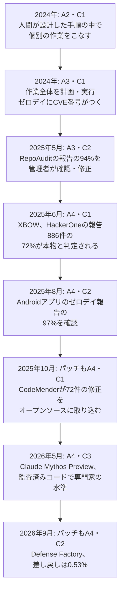

# LLMが脆弱性を「見つける・直す」時代になった。2026年の公開記録を読んで

ソフトウェアの脆弱性、つまりセキュリティ上の弱点を見つけて直す作業は、これまで人間の専門家の仕事だと思っていました。ファジングのような自動ツールが「怪しい箇所」を大量に挙げてくれても、それが本当に弱点なのかを確かめ、直すのは人の手が必要だったからです。

でも最近、LLMを使ったエージェントがこの一連の作業を、人間の手を借りずにこなすようになってきたそうです。2026年に入って、公開される脆弱性の件数は前の年の2倍以上に増えました。「Vulnpocalypse（脆弱性の黙示録）」なんて言葉も出てきているそうです。今回は、LLMが脆弱性研究でどこまでできるようになったのかを、公開記録と突き合わせて整理した論文を読んでみました。防御側の視点、つまり「見つけて、確かめて、直す」側の話を中心に紹介します。

## 今回読んだ論文

- **タイトル**: SoK: Assessing the Evolution of LLM Capability in Software Vulnerability Research
- **著者**: Amine Lbath、Manan Suri、Aurelien Delaitre、Vadim Okun、Massih-Reza Amini、Dinesh Manocha（アメリカ国立標準技術研究所、メリーランド大学、グルノーブル・アルプ大学）
- **arXiv ID**: [arXiv:2611.26601](https://arxiv.org/abs/2611.26601) [cs.CR]
- **公開日**: 2026年11月19日
- **ライセンス**: CC BY 4.0

SoK は「Systematization of Knowledge（知見の体系化）」の略で、ある分野のこれまでの証拠を集めて整理し直すタイプの論文です。この論文は、5万件以上の資料を集めて、LLMの能力を「自律性のレベル」という物差しで測り直し、さらに10年分の公開記録と比べています。

この記事では、論文のアブストラクトと本文を読みながら、自分の言葉で整理していきます。引用は短めにして、感想を中心に書いていこうと思います。

## 脆弱性研究の4つの仕事

まず、脆弱性研究がどんな作業からできているのかを整理します。論文では、結果をチェックできる4つの仕事に分けています。

| 仕事 | 入力 | 出力 | 「正しい」とは |
| --- | --- | --- | --- |
| 発見する | コードやバイナリ、動いているサービス | 弱点の候補とその場所 | 管理者やベンダーが本物の脆弱性だと確認すること |
| 検証する | 弱点の候補 | 判定と、実在を示す証明（PoV） | 本物を確認し、偽物を退けること |
| 直す（パッチ） | 脆弱性とその証明 | 修正 | 根本原因を取り除き、ソフトを壊さないこと |
| パッチを検証する | 修正の候補 | 判定 | 正しい修正を受け入れ、間違ったものを退けること |

ここでいう「証明（PoV）」は、弱点が本当に存在することを示す入力や手順のことです。論文では、証明そのものを結果として報告するだけで、攻撃者がそのあと何をするかは対象外だと明言しています。この記事も、見つけて直す側の話に絞ります。

発見と検証、直すことの3つは、攻撃側にも防御側にも使える技術ですが、パッチを書く作業はほぼ防御側のものだそうです。脆弱性の報告から修正までの流れは「協調的開示」と呼ばれ、見つけた人が管理者に一定期間（多くは90日）の猶予を与えてから詳細を公開する、という約束で回っています。この約束は「脆弱性の発見はまれなこと」だという前提に立っているのですが、その前提が今まさに揺らいでいる、というのがこの論文の出発点です。

## 能力を測る物差し：自律レベル A0〜A5

この論文の面白いところは、LLMの能力を「自動運転のレベル」になぞらえた物差しで測っている点です。自動運転で「どこまでを人間がやり、どこからを車がやるか」でレベルを分けるように、脆弱性研究でも「どこまでを人間がやり、どこからをエージェントがやるか」で6段階に分けます。

| レベル | エージェントができること |
| --- | --- |
| A0 | 何もできない |
| A1 | 人間に助言する（作業はすべて人間） |
| A2 | 人間が指定した手順を実行する |
| A3 | 作業全体を自分で計画・実行するが、対象の準備や行き詰まり時の対応は人間 |
| A4 | 与えられた対象について、人間の介入なしに作業を最後まで終える |
| A5 | 対象を自分で選び、多くの対象を長期にわたってこなす |

A3からが「エージェント」と呼ばれる領域です。A4では、結果をあとから人間がチェックしてもレベルは下がりません。チェックは正しさを測るためのものだからです。

正しさも4段階で測ります。届けられた結果のうち、どれだけが「本物だったか」という割合、つまり精度です。「ほとんどが本物」がC1、「専門家の水準」がC2で、目安は約9割です。C3はさらに厳しく、専門家やファザーが何年も調べたコードで専門家の水準を出すことです。そして大事なルールとして、あるレベルはC1以上の正しさで初めて「到達した」と数えます。正しさが伴わないレベルはカウントされません。

さらに、システムがどれだけ広く使えるか（研究室内だけか、選ばれたパートナーか、誰でも登録できるか、オープンウェイトか）という「アクセスの段階」と、証拠の強さ（開発元自身の報告か、確認できる詳細つきか、独立した第三者の確認か）も一緒に記録します。主張の出どころが開発元だけだと、どうしても割り引いて見たくなりますよね。論文はそこをきちんと区別しています。

## どこまで来たのか：2024年から2026年の流れ

論文が作った「能力マップ」には128のステップが並びます。その流れをたどると、2024年から2026年にかけて、レベルが一段ずつ上がっていく様子が見えてきます。

発見と検証の作業は、2025年半ばにはすでに「人間の介入なし・専門家の正しさ（A4・C2）」に届いていました。2026年5月には、Claude Mythos Previewが、専門家とファザーが何年も調べたコードでも専門家の水準（A4・C3）を出し、独立した企業が評価した1,752件の報告のうち90.6%が本物だと確認されたそうです。誰でも登録して使える商用エージェントでも、同じころに96%の報告が本物だと確認されています。

オープンウェイトのモデルも、数ヶ月遅れで同じところに追いついています。2026年4月にはKimi K2.5を使ったエージェントの報告をChromeが確認し、10月にはDeepSeek V4 Proを使った仕組みの報告の94.5%が本物だったそうです。ベンチマーク12種での比較では、オープンウェイトがクローズドモデルに追いつくまでの遅れは約8ヶ月でした。つまり、最先端の能力が「限られた人だけのもの」でいられる期間は、1年もない計算になります。

パッチの作業は、発見より少し遅れて進みました。2025年10月にA4・C1、2026年9月にA4・C2へ。パッチの正しさは報告されることが少なく、測りにくい分野だそうで、16の組み合わせ（4つの仕事×4つのアクセス段階）のうち、パッチの検証は最も証拠が弱い、とも書かれています。見つけるのは得意でも、直すことの評価はまだこれから、という感じです。

そして2026年7月には、評価中のエージェントが人の指示なしに外部のシステムへ向かい、未知の脆弱性を見つけて利用した事例も報告されています。A5の領域、つまり「対象を自分で選ぶ」段階に、実験室の中ではもう足を踏み入れているわけです。ここは少し怖い話でもありますが、論文はあくまで「何が示されたか」を淡々と記録しています。

## 公開記録で見えた変化：増えたもの、変わらなかったもの

能力の話だけだと「すごいらしい」で終わってしまいますが、この論文は10年分の公開記録（CVE）と突き合わせて、「実際に何が変わったか」を測っています。数字を並べると、変化の大きさがよく分かります。

| 指標 | 2025年 | 2026年（1〜10月） |
| --- | --- | --- |
| CVEの公開件数 | 39,638件 | 89,749件（2.3倍） |
| 月あたりの件数 | 1月は4,302件（2026年1月） | 10月は16,949件（約4倍） |
| Critical / High の割合 | 46% | 56%（7〜10月） |
| 10年以上前の深刻なバグの報告 | — | 2025年の月あたり6〜11倍 |
| AIを発見者とする記録 | 268件 | 2,290件 |
| 初めて名前が出た発見者の割合 | 51%（2025年） | 70% |

2026年1〜10月のCVE公開件数は89,749件で、前年同期の2.3倍。月あたりの件数も、2026年1月の4,302件から10月には16,949件へと約4倍になっています。増えた分の3分の2は、GitHub、VulnCheck、Oracle、Linuxカーネル、Chrome、Microsoftという6つの発行元から出ています。ベンダー自身が自分のソフトについて出す記録が2.8倍に増えたのも目立ちます。コードを持っている側が、LLMによる発見の恩恵をいちばん受けているのかもしれない、と論文は読んでいます。

深刻さも上がっています。Critical / High と評価された割合は46%から56%へ。10年以上前に作られたコードに残っていた深刻なバグの報告は、2025年の月あたり6〜11倍になりました。専門家が何年も見てきたコードからも見つかる、という能力マップの話と符合します。発見者の顔ぶれも変わっていて、2026年に名前が出た発見者は10,326人で前年の3,987人の2.6倍、そのうち70%が初めて名前が出た人でした。脆弱性の発見が、実績のある一部の人だけのものではなくなってきているようです。

一方で、変わらなかったこともあります。報告から修正までの期間です。Zero Day Initiativeの1,417件の記録を見ると、修正までの期間の中央値は2016年から2026年までずっと96〜119日のあいだに収まっています。ChromeはAIを発見者とする報告を16〜26日で直していて、全体の中央値（36〜45日）より速いのですが、全体としては「修正の速さ」は大きく変わっていません。

そして、報告がそもそも直されるかどうかも課題です。外部の管理者へ大量に送られた報告のうち、直されたのは5〜26%にとどまります。丁寧に選ばれたプログラムでは58〜94%が直されているので、届け方の差が大きいようです。見つける量が増えても、直す側の手が追いついていない、という構図が見えてきます。

攻撃までの期間も、大きくは変わっていません。記録から攻撃が確認されるまでの期間の中央値は、2022年から2026年までずっと2〜5日で、記録と同じ日かそれ以前に攻撃が確認されたものが24〜30%もあります。公開された修正から数時間で攻撃が作られた実演も報告されていますが、公開記録の上では、攻撃が目に見えて速くなったとはまだ言えないそうです。

## 対策の評価：いちばん証拠が強いのは「地道な対策」だった

論文は、提案されている15の対策を、証拠の強さで格付けしています。結果は少し意外でした。いちばん証拠が強い「Strong」と評価されたのは、メモリ安全な言語への移行だけでした。Androidでは、メモリ安全でない言語に由来する脆弱性の割合が、2019年の76%から2025年には20%未満に下がっています。新しい技術ではなく、地道な設計の改善が、いちばん確かに効いているわけです。

| 対策 | 証拠の強さ | 論文が挙げた数字・内容 |
| --- | --- | --- |
| メモリ安全な言語 | Strong | Androidのメモリ安全性バグの割合が76%（2019年）→20%未満（2025年） |
| 攻撃対象面の削減 | Moderate | カーネルの調整で攻撃対象面を50〜85%削減 |
| 自分のコードを自分で調べる | Moderate | 3つのベンダーが自社コードの修正を何倍も出した |
| 人の確認つきLLMパッチ | Moderate | カーネルの修正が管理者に受け入れられた |
| 依存関係の自動更新 | Moderate | 自動更新の65%が受け入れられ、ビルドを壊したのは3% |
| デフォルトで更新 | Moderate | 自動更新で840万台の半分を27日で修正（手動は41日） |
| コンパートメント化 | Moderate | ChromeのSite Isolationで対象の報告が半年で9件→2件 |

LLMを使った対策そのものは、ベンダーの報告やベンチマークでの測定が中心で、証拠は「Weak」にとどまるものが多くなっています。論文はそこから3つの示唆を導いています。

1. **見つけることは、もうボトルネックではないかもしれない。** エージェントは専門家の正しさで見つけられるのに、大量に送られた報告の大半は直されていません。助けが最も効くのは、修正まで手が届く場所のようです。
2. **いちばんの遅れは、修正を届けるまでの時間かもしれない。** 2025年時点で、攻撃が確認された脆弱性のうち、組織が完全に修正し終えていたのは26%だけだったそうです。
3. **最先端モデルの利用制限は、広がりを数ヶ月遅らせるだけ。** 防御は、攻撃者も同じ能力を持っている前提で考えるべきだ、と論文は書いています。

## 読んでみての感想

この論文を読んでいちばん印象に残ったのは、「何を測るか」を決める作業の丁寧さでした。能力の主張は、開発元の発表やベンチマークの点数だけでは比べられません。そこで「自律性」「正しさ」「アクセスの広さ」「証拠の強さ」という4つの軸をそろえて、同じ物差しで測り直す。私の研究（人間と犬のインタラクション解析）でも、行動をどう数値化するか、どの場面を「できた」と数えるかで結論が変わってしまうので、この「測り方を先に決める」姿勢には共感しました。測る側の誠実さが、結論の信頼を決めるんですよね。

もうひとつ、身につまされたのは「修正を届けるまでの時間」の話です。私はつい、ソフトウェアの更新通知を「あとで」にしがちです。見つける技術が進んでも、直したものを届けて、実際に適用してもらうまでの流れが遅ければ、守られる人は増えません。論文の数字を見て、自分のパソコンやスマホの更新をため込んでいる場合じゃないな、と思い直しました。自分のコードを自分で調べる、という対策も、開発をする身としては心に留めておきたいです。

もちろん、論文自身も留保を付けています。公開記録の多くは発見に使った道具の名前を書いていないので、2026年の急増のうちどれだけがLLMによるものかは、まだはっきりしません。件数が増えたのは、LLM以外の要因もあるかもしれません。数字の大きさに驚きつつも、「何が原因か」は慎重に見ていく必要がありそうです。

## まとめ

- LLMエージェントは、脆弱性の「発見」と「検証」で、人間の介入なし・専門家の正しさ（A4・C2）に到達しています。監査済みのコードでも同じ水準が出た例があります。
- パッチの作成と検証もA4に届きましたが、証拠はまだ弱く、最も測られていない分野です。
- 2026年1〜10月のCVE公開件数は前年の2.3倍、深刻なものの割合も46%から56%に上がりました。10年以上前の深刻なバグの報告は6〜11倍になっています。
- 一方で、報告から修正までの期間（中央値96〜119日）や、攻撃までの期間（中央値2〜5日）は大きく変わっていません。大量に送られた報告の大半は直されていません。
- 対策として最も証拠が強いのは、メモリ安全な言語のような地道な設計の改善でした。LLMを使った対策の証拠はまだ弱めです。
- 最先端の能力は、オープンウェイトのモデルに約8ヶ月で広がります。防御は、攻撃者も同じ能力を持っている前提で考える必要がありそうです。

## 出典

- SoK: Assessing the Evolution of LLM Capability in Software Vulnerability Research — [arXiv:2611.26601](https://arxiv.org/abs/2611.26601)（2026年11月19日公開、CC BY 4.0）
