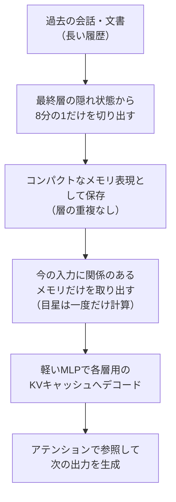

# LLMに「覚える力」をつけると、100万トークンの会話が軽くなる。MemOnceを読んで

長い会話を続けていると、AIがだんだん前の話を忘れてしまったり、返事が遅くなったりした経験はありませんか。私も、長い資料を読み込ませながら何度もやり取りするうちに、「さっき話した内容、もう一度言わないと伝わらないのかな」と感じることがあります。

今回読んだ論文は、そんな「長く付き合うほど重くなる」問題に、モデルの中身から向き合ったものです。タイトルは MemOnce。LLMに「覚える力」を持たせるための新しいアーキテクチャの提案です。100万トークンの文脈でも、メモリ使用量を1,313分の1に減らしたという、なかなかインパクトのある数字が出ています。

## 今回読んだ論文

- **タイトル**: MemOnce: A Scalable Memory Architecture for Large Language Models
- **著者**: Chang Nie、Chaoyou Fu、Songlin Liu、Yiqing Hu、Caifeng Shan（南京大学、中国科学技術大学）
- **arXiv ID**: [arXiv:2611.27973](https://arxiv.org/abs/2611.27973) [cs.CL]
- **公開日**: 2026年11月20日
- 論文のHTML版: https://arxiv.org/html/2611.27973v1
- プロジェクトページ: https://clare-nie.github.io/MemOnce

## なぜ「覚える」ことが難しいのか

今のTransformerは、過去の会話を「KVキャッシュ」という形で、層ごと・トークンごとに全部覚えています。会話が長くなるほどキャッシュはどんどん膨らみ、GPUメモリは線形に増え、計算量は二乗で増えていきます。100万トークンの会話ともなると、キャッシュだけで大変なことになってしまうわけです。

一方で、履歴を固定サイズの状態にぎゅっと圧縮する「線形時間アーキテクチャ」もあります。こちらは軽いのですが、細かい内容が抜け落ちやすいという弱点があります。「軽いけど忘れっぽい」か「覚えているけど重い」か、どちらかを選ばないといけない、というのがこれまでの構図だったそうです。

MemOnceは、この二択を崩そうとしています。「覚えるけど軽い」を両立させるのが狙いです。

## MemOnceの仕組み：2つの工夫

MemOnceの核になっているのは、名前の通り「一度だけ（Once）」という考え方を徹底した、2つの設計です。

### 工夫1：メモリエンコーダ・デコーダ（覚えるのは一度だけ）

普通のTransformerは、各層ごとにKVキャッシュを持ちます。層が32層あれば、同じ会話の情報が32層分、別々に保存されることになります。

MemOnceはここを大胆に変えました。覚えるのは**最終層の隠れ状態のうち、ごく一部だけ**。たとえば8分の1だけを切り出して、コンパクトな「メモリ表現」として保存します。使うときには、軽いMLPで各層用のKVキャッシュへと「デコード」し直します。

つまり、保存は一度だけ、しかも少量。使うときに必要分だけ広げる、という設計です。論文によると、この工夫で持続的なメモリは「層数 × 圧縮率」倍だけ小さくなるそうです。層の分だけ重複していたムダを、まるごとなくしてしまったイメージです。

### 工夫2：メモリ・スパースアテンション（探すのは一度だけ）

覚えたものを全部使うのではなく、**今の入力に関係のあるものだけ**を取り出して使います。ここで大事なのは、「どれが関係あるか」という目星（スパースなインデックス）を、全ての層で共通して一度だけ計算する、という点です。

層ごとに毎回「どれを使おうか」と探し直していたら、その分だけ計算が増えてしまいます。一度決めた目星を全層で使い回すことで、探すコストも最小限に抑えています。

この2つの「一度だけ」が組み合わさることで、線形時間の計算量と、ほぼ一定のメモリ使用量が実現されている、というのが論文の主張です。

## さらに二段構え：短期メモリと長期メモリ

MemOnceは、メモリの置き場所も二段構えにしています。

- **短期メモリ**: 直近の圧縮された状態をGPU上に置くスライディングウィンドウ。たとえば16チャンク分で、GPU上の使用量はつねに5.0MBほどに収まるそうです。
- **長期メモリ**: 古くなった状態はホストメモリやSSDへ逃がす。必要になったときだけ取り出します。

「今まさに使うものは手元に、昔のものは倉庫に」という、私たちの生活にも似た整理の仕方だなと思いました。128Kトークンの文脈での計測では、関係のあるメモリ64個（20.00MB）をSSDから読み出すのに3.85ミリ秒しかかからなかったそうです。取り出しの速さも、実用上の大事なポイントだと思います。

## 取り出しの速さを比べてみる

同じ128Kトークンの文脈で、他の手法と「記憶を取り出すのにどれだけ時間がかかるか」を比べた結果も論文に載っていました。

| 手法 | 記憶の取り出しにかかる時間 |
| --- | --- |
| MemOnce | 約64ミリ秒（SSDから読み出す場合） |
| M+ | 約773ミリ秒 |

MemOnceはクエリのエンコードに1回のフォワードパス（約60ミリ秒）を使い、そこへSSDからの読み出し（3.85ミリ秒）を足した合計が約64ミリ秒。一方M+は、全32層で層ごとに取り出しを行うため、1,150MBもの状態をCPUからGPUへ転送することになり、約773ミリ秒かかっていたそうです。10倍以上の差がついています。

「探すのは一度だけ」という設計が、ここでも効いているわけです。層ごとに探し直すと、探す回数が層の数だけ増えてしまう。MemOnceはそのムダをなくしたことで、取り出しも速くなっています。長い会話で「前の話を思い出すたびに待たされる」のでは使い物になりませんから、この速さは実用面でかなり大事だと思います。

## 実験の結果：数字で見るとどうなのか

論文では、150Mから1Bパラメータまでのモデルを一から学習した実験と、Qwen3.5-4Bを事後学習でMemOnce化した実験の両方が行われています。4Kから100万トークンまでの5つのメモリベンチマークで評価した結果が、なかなかすごいです。

| 指標（100万トークン時、Qwen3.5-4B） | 結果 |
| --- | --- |
| メモリ状態キャッシュ | 1,313分の1に削減 |
| プリフィル遅延 | 6.9分の1に短縮 |
| スループット | 3.5倍に向上 |
| メモリ性能（5ベンチマーク平均） | フルコンテキスト比 +5.77% |

ここで驚いたのは、軽くなっただけでなく、**性能も上がっている**ことです。フルコンテキスト（全部覚える方式）よりも+5.77%、先行するメモリ手法のM+より+18.68%、Metisより+32.27%良い成績だったそうです。論文では「フルコンテキストのベースラインを超えた初めてのネイティブメモリモデル」と書かれています。

| 手法 | メモリ性能（フルコンテキスト比） |
| --- | --- |
| MemOnce | +5.77% |
| M+ | -12.91%相当（MemOnceより18.68%低い） |
| Metis | -26.50%相当（MemOnceより32.27%低い） |

※M+・Metisの値は、論文中の「MemOnceより◯%低い」という記述から換算したものです。

圧縮率を8倍にしても、圧縮しない場合と比べてほとんど性能が落ちなかった、というアブレーション結果もありました。「8分の1だけ残す」のは、かなり思い切った圧縮に思えますが、文脈の要点は末尾のトークンに集約できる、というのが論文の見立てです。

## 「忘れない」だけじゃない：汎用能力を壊さない工夫

メモリ機能をつける代わりに、もともとの推論能力が落ちてしまう「破壊的忘却」も、メモリ付きモデルの悩みどころです。論文では、32Kトークンのメモリ負荷をかけた状態での一般推論タスクで、他の手法が大きく性能を落とす中、MemOnceは最も高い平均を保ちつつ、メモリの想起性能も優れていたと報告されています。たとえばソフトプロンプト注入型の手法は-18.22%、線形状態型の手法は-22.53%も落ちたそうです。

これは、推論時にモデルの重みを固定したまま、履歴を「デコードしたKVキャッシュ」としてだけ扱う設計のおかげだと論文では説明されています。メモリが本体の能力を邪魔しない、というのは、長く使う道具としては大事な性質だと思います。

## 私の研究とのつながり

私の研究は人間と犬のインタラクション解析で、動画の観察記録を長い時間軸で追うことがあります。長い観察の中で「あの場面ではどうだったか」を思い出しながら分析する作業は、まさに「長い履歴を覚えて、必要なときに取り出す」作業です。MemOnceのように「全部覚えるのではなく、要点を圧縮して、必要なものだけ取り出す」という発想は、人の記憶の仕組みにも少し似ている気がして、親しみを感じました。

もちろん、モデルのメモリと人の記憶は別物ですが、「覚える量」と「思い出す速さ」のバランスをどう取るか、という問いは、研究でも日常でも共通しているのかもしれません。

## 気になる点・今後の展望

論文の主張は力強い一方で、気になる点もあります。まず、実験の多くはQwen3.5-4Bという1つのモデル系列での事後学習が中心で、他のモデル系列やもっと大きな規模で同じ効果が出るかは、まだこれからの検証だと思います。また、「関係のあるメモリだけ取り出す」という仕組みは、取り出しの目星（インデックス）の精度に性能が左右されそうです。目星が外れたら、必要な記憶が使われないわけですから、この部分の頑健さは今後の課題として注目したいところです。

とはいえ、「軽くて、覚えていて、性能も落ちない」という三拍子が、実際に数字で示されたこと自体が大きな一歩だと思います。長い会話やエージェントの長時間タスクが当たり前になる中で、こうした「覚える仕組み」の進化は、これからますます重要になってきそうです。

## まとめ

- MemOnceは、最終層の隠れ状態のごく一部だけをメモリとして保存し、使うときにKVキャッシュへデコードし直すアーキテクチャです。
- 関係のあるメモリだけを一度の目星で取り出す「メモリ・スパースアテンション」と組み合わせることで、線形時間・ほぼ一定のメモリ使用量を実現しています。
- Qwen3.5-4Bでの評価では、100万トークン時にメモリ1,313分の1、プリフィル遅延6.9分の1、スループット3.5倍、しかもフルコンテキストより+5.77%の性能でした。
- 破壊的忘却を抑えつつ、ゼロショットで表現タスクにも使える汎用性も示されています。

長い付き合いができるAIは、ただ賢いだけではなく、「覚え方がうまい」AIなのかもしれません。MemOnceは、その方向への一つの答えを示してくれた論文だと思いました。

## 参考

- 論文: [MemOnce: A Scalable Memory Architecture for Large Language Models](https://arxiv.org/abs/2611.27973)（arXiv:2611.27973、2026年11月20日公開）
- プロジェクトページ: https://clare-nie.github.io/MemOnce

