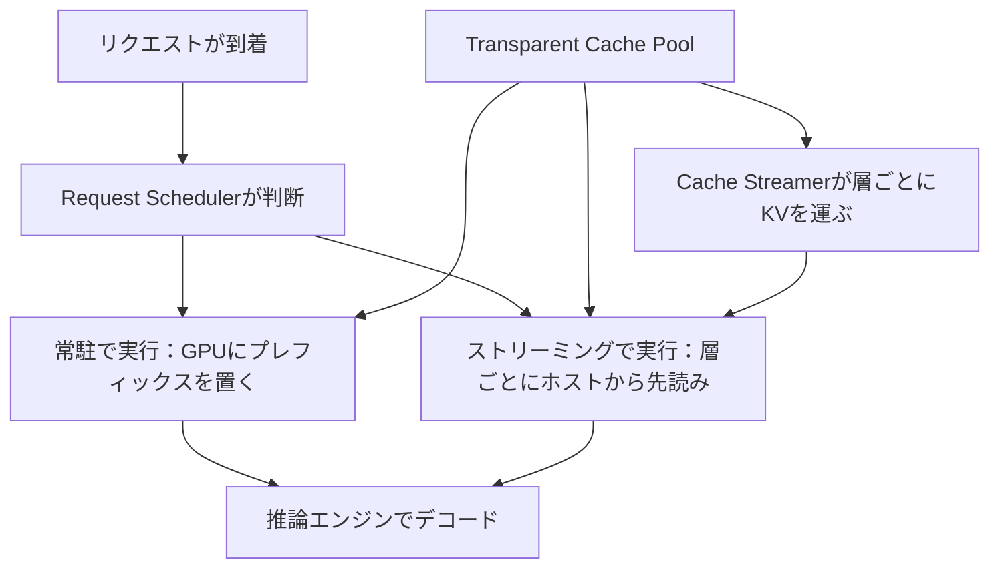

# LLMの推論を速くする鍵は「キャッシュの使い回し」だった。TideCacheを読んで

最近のLLMは、チャットで質問に答えるだけではなく、コーディングエージェントとして何度もツールを使ったり、長い資料を読み込んで分析したりと、働き方がずいぶん広がってきました。こうした使い方では、モデルに「前のやり取りを覚えておいてもらう」ことが大事になります。覚えておくための仕組みがキャッシュなのですが、実はこのキャッシュの置き場所や管理の仕方が、推論の速さや一度にさばけるリクエストの数を大きく左右するそうです。

今回は、そんなキャッシュ管理を工夫して、エージェントの処理を最大で2倍以上こなせるようにした、という論文を読んでみました。モデルの重みを変える話ではなく、「すでにあるメモリをどう使い回すか」という、ちょっと地味だけど効き目の大きい話です。

## 今回読んだ論文

- **タイトル**: TideCache: Efficient Hybrid LLM Serving with Transparent Cache Management and Layer-Wise Streaming
- **著者**: Jinbin Luo、Xiaozhe Yao、Shang Yang、Zhijian Liu、Song Han、Qinghao Hu（MIT、ETH Zurich、UC San Diego）
- **arXiv ID**: [arXiv:2611.26619](https://arxiv.org/abs/2611.26619) [cs.DC / cs.LG]
- **公開日**: 2026年11月19日

この記事では、論文のアブストラクトと本文を読みながら、自分の言葉で整理していきます。引用は短めにして、感想を中心に書いていこうと思います。

## まず前提：いまのLLMは「ハイブリッド」になっている

最近のオープンなLLMは、Kimi K3やRing-2.6、GLM-5.3-Flash、Qwen3.8、GPT-OSSといったモデルがそうであるように、「ハイブリッドアーキテクチャ」が主流になっているそうです。どういうことかというと、モデルの層のうち、全体を見渡す「グローバルアテンション層」は数層に1回だけ置いて、残りの層はスライディングウィンドウやMamba、Gated DeltaNetといった「状態の大きさが文脈の長さに依存しない層」で埋める、という作りです。論文では後者を「bounded-state層（状態が有界な層）」と呼んでいます。

推論のとき、モデルは入力に対して各層の状態を作ります。これがキャッシュです。層の種類によって、キャッシュの性質が違います。

- **グローバルアテンション層**：すべてのトークンを見るので、KVキャッシュが文脈の長さとともに大きくなる
- **bounded-state層**：直近のウィンドウだけ、あるいは固定サイズの状態だけを持つので、文脈が長くなってもキャッシュは大きくならない

たとえばRing-2.6-1TをTP4（4枚のGPUに分割）で動かす場合、6万7千トークンの文脈でグローバルKVはGPUあたり約0.72 GiBになる一方、再帰状態のスロットは1つあたり35 MiBだそうです。文脈が長くなればなるほど、グローバルKVのほうだけがどんどん膨らんでいく、というわけですね。

## 問題その1：キャッシュの「仕切り」が固定だと、片方が余って片方が足りなくなる

サーバーでは、GPUのメモリを「グローバルKV用」「ウィンドウKV用」「再帰状態用」といった具合に分けて使います。ところが、どの部分がボトルネックになるかは、ワークロードによって変わります。チャットやラベリングのようにリクエスト数が多いと、bounded-state側のキャッシュが先にいっぱいになります。逆にコーディングエージェントや資料分析のように文脈が長いと、グローバルKVのほうが先にいっぱいになります。

論文の例では、Ring-2.6-1TをSGLangのデフォルトの仕切りで動かすと、状態プールが同時実行数を61リクエストまでに制限してしまい、グローバルKVのほうはまだ余っている、という状況が起きるそうです。逆に1リクエストあたり6万4千トークンの文脈だと、グローバルKVが17リクエスト分しか入らず、今度は状態プールが余る。どちらかに寄せた仕切りを作っても、ワークロードが変わればまた偏ってしまう。固定の仕切りでは、どうしても「余っているのに使えないメモリ」が出てしまうんですね。

既存のシステムにも、動的に分け直す仕組みはあります。SGLangのUnified Memory PoolやvLLMのHybrid KV Cache Managerがそれです。ただ、共有の領域にいろいろなレイアウトを詰め込むと、注意機構のバックエンド側に合わせた変更が必要になったり、ホストメモリへのオフロードと相性が悪かったりする、という課題があるそうです。

## 問題その2：デコード中、CPUとGPUの間の回線がほぼ遊んでいる

もうひとつの着眼点が、CPUとGPUをつなぐ回線の速さです。最近のCPU–GPUスーパーチップでは、この回線がとても速くなっています。

| プラットフォーム（年） | 接続方式 | 帯域 |
| --- | --- | --- |
| A100（2020年） | PCIe 4.0 x16 | 64 GB/s |
| H100（2022年） | PCIe 5.0 x16 | 128 GB/s |
| GH200（2023年） | NVLink-C2C | 900 GB/s |
| GB300（2025年） | NVLink-C2C | 900 GB/s |
| VR300（2026年） | NVLink-C2C | 1,800 GB/s |

A100の時代と比べると、VR300では28倍です。論文によると、GB300のGPUはホストメモリを211 GB/sで読めるそうで、Ring-2.6-1Tの1デコードステップ（57ミリ秒）なら、1GPUあたり約12 GBも運べる計算になります。

ところが、従来のオフロード方式（HiCacheなど）では、セッションの冒頭で必要な分をまとめてGPUに戻して、そのあとデコード中はずっとGPUに置きっぱなしにします。つまり、デコードの大半の時間、この速い回線はほとんど使われていないんです。もったいないですよね。

そしてハイブリッドモデルには、ちょうどいい性質があります。グローバルアテンション層のあいだには、グローバルKVを必要としないbounded-state層が何層も挟まっています。Ring-2.6では、グローバル層のあいだに7層のbounded-state層があるそうです。この「計算しているあいだの時間」を使って、次のグローバル層の分だけをホストメモリから先読みして、使い終わった層の分は捨てれば、GPUに置いておく量をぐっと減らせるはずです。

## TideCacheの3つの仕組み

こうした観察から、論文はTideCacheというシステムを提案しています。3つの部品からなります。

**1. Transparent Cache Pool（透明なキャッシュプール）**

GPUのメモリを、グローバルKV・ウィンドウKV・再帰状態の3つのサブプールに分けて管理します。ポイントは、各サブプールが「固定の仮想アドレス範囲」を持ち、裏側の物理ページだけを動かす、という点です。足りなくなったサブプールを「受け手」として、余っているサブプールから物理ページを移します。データそのものをコピーしたり、アドレスを変えたりしないので、注意機構のバックエンドやキャッシュの仕組みを変える必要がありません。

ページの移動は、8回のフォワードパスを1エポックとして、1エポックに1回だけ行われます。まず「どのページを誰に渡すか」を計画し、使われていないページを確保してから、フォワードパスが終わるのを待って、実際にページの付け替えをします。使われている最中のページには触れない、という慎重な手順です。

受け手に渡すページは、コストの低い順に集めます。まず誰にも割り当てられていない空きページ、次に他のサブプールの使われていない容量、最後に「しばらく使われていない冷えたキャッシュ」です。よく使われている熱いキャッシュは、捨てると再計算が必要になるので、奪わないようにしています。

**2. Cache Streamer（キャッシュストリーマー）**

ホストメモリにあるプレフィックスを、必要なグローバルアテンション層の直前にだけGPUへ運ぶ仕組みです。全部の層の分をGPUに置くのではなく、層の数Lに対してスロットはM=2個だけを共有します。層ごとにスロットを使い回すので、GPUに置く量は全体のM/Lにまで減ります。生成したばかりの新しいKVはGPUに残したままにします。

転送と計算を重ね合わせるために、2つのスロットを交互に使う「ダブルバッファ」方式をとります。たとえば、ある層のKVをスロットBから読み終わったら、そのあいだに次の層のKVをスロットBへコピーしておく、という具合です。さらに、転送の完了を待つための小さなフラグをCUDAグラフの中に組み込んでおく「Graph-Compatible Handshake」という工夫で、グラフを分割せずに、必要な分だけ選んで転送できるようにしています。

**3. Request Scheduler（リクエストスケジューラ）**

待ち行列の先頭のリクエストを、GPU常駐で実行するか、ストリーミングで実行するかを決めます。どちらも入らなければ、どのキャッシュが足りないかをTransparent Cache Poolに伝えて、容量を増やしてもらいます。リクエストの大きさや行列の状態を見て、実行方法と容量調整を調整する、いわば司令塔です。

## 数字で見る効果

TideCacheはSGLangに実装され、GB300とGH200の2種類のスーパーチップで、7つのモデル／プラットフォーム構成で評価されました。比較対象は、HiCache付きのSGLangです。

| 指標 | 結果（HiCache付きSGLangとの比較） |
| --- | --- |
| エージェントのターン完了数 | 最大で2.04倍 |
| P50のトークンあたりレイテンシ | 20〜59%削減 |
| エージェントのP50 TTFT（最初のトークンまでの時間） | 1.40〜3.05倍改善 |
| 変化するワークロード（GH200）でのターン完了数 | 59%増加、TTFTは78%削減 |
| 同じバッチサイズでのデコードステップの遅延 | 最大で6.3%の追加にとどまる |

Transparent Cache Poolだけを取り出してみても、手作業で調整した仕切りのうち良いほうと比べて、96.3〜113.6%のターン数を達成できたそうです。つまり、自動で分け直す仕組みが、手でちょうどよく調整した仕切りとほぼ同じか、それ以上の働きをしている、ということです。

「速くなる代わりに、1ステップあたりの遅延が増えるのでは？」という心配も、同じバッチサイズで比べると最大で6.3%の追加にとどまるそうです。転送を計算の裏側に隠せているからこその数字だと思います。

## 私なりの整理：モデルの中身ではなく「置き場所の工夫」で速くなる

ここからは、私なりの感想です。この論文を読んでいちばん面白かったのは、モデルの賢さや重みをいじるのではなく、「キャッシュをどこに置いて、どう使い回すか」という運用の工夫だけで、ここまで性能が変わる、という点です。

ハイブリッドモデルは、層によってキャッシュの性質が違う、という「ばらつき」を持っています。ふつう、ばらつきは扱いにくいものだと思いがちです。でもTideCacheは、そのばらつきをむしろ利用しています。bounded-state層の計算時間を使って転送を隠す、サブプールごとに余り具合が違うからこそ動的に分け直す価値がある。弱点に見える性質を、強みに変えている感じがします。

あと、「透明性」を大事にしているのも印象的でした。仮想アドレスを固定したまま物理ページだけを動かす、という設計のおかげで、既存の注意機構やキャッシュの仕組みを書き換えずに済んでいます。速くするために全体を壊して作り直すのではなく、裏側だけをそっと変える。こういう「壊さない工夫」は、実際のシステムに取り入れるときのハードルを下げてくれるので、ありがたいなと思います。

私の研究は、人間と犬のインタラクションを動画から解析するものです。直接は関係ないのですが、「表面に見える速さや性能の裏側で、リソースがどう配分されているかを見る」という姿勢は、なんだか通じるものがあるなと感じました。犬の行動を観察するときも、表面的な動きだけを見ていると見落とすものがあって、「その裏で何が起きているか」を確かめることが大事です。論文を読むときも、数字の裏にある仕組みまで追うと、理解がぐっと深まる気がします。

もちろん、TideCacheの評価はGB300やGH200といった最新のスーパーチップで行われたもので、手元の環境で同じ効果が出るとは限りません。ただ、「速い回線が遊んでいる時間を使う」「余っているメモリを必要なところへ回す」という考え方自体は、ハードウェアが変わっても通じるものだと思います。

## まとめ：持ち帰れるポイント

- 最近のLLMはハイブリッド構造が主流で、層によってキャッシュの性質が違う（グローバルKVは文脈とともに膨らむ、bounded-state層は固定サイズ）
- 固定の仕切りでは、ワークロードによって片方のキャッシュが余り、片方が足りなくなる
- デコード中はCPU–GPU間の高速な回線がほぼ遊んでいる。bounded-state層の計算時間を使えば、必要な層のKVだけを先読みできる
- TideCacheは3つの仕組み（Transparent Cache Pool、Cache Streamer、Request Scheduler）でこの問題に取り組み、エージェントのターン完了数を最大2.04倍、P50レイテンシを20〜59%削減した
- 仮想アドレスを固定したまま物理ページだけを動かす設計で、既存の仕組みを壊さずに導入できる

LLMの進化というと、モデルの規模や学習方法の話に目が向きがちです。でも、こうした「動かす側の工夫」も、実際に使うときの体感を大きく変えるんだな、と改めて感じました。SGLangで実装されているので、興味のある方は論文とあわせて、実装のほうものぞいてみると面白いかもしれません。

## 参考リンク

- 論文: [TideCache: Efficient Hybrid LLM Serving with Transparent Cache Management and Layer-Wise Streaming](https://arxiv.org/abs/2611.26619)（arXiv:2611.26619、2026年11月19日公開）
- 論文のHTML版: https://arxiv.org/html/2611.26619v1

